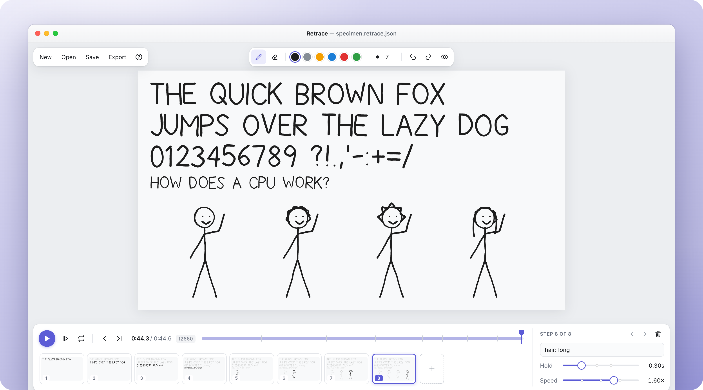

<p align="center">
  
  
</p>

<h1 align="center">Retrace</h1>
<h3 align="center">Draw step by step. Play it back like a human drew it.</h3>

<div align="center">



<p align="center">
  <a href="LICENSE"></a>
  <a href="#use-it-with-ai-mcp"></a>
  
  <a href="https://github.com/jub0t/Retrace/pulls"></a>
</p>

</div>

## About

Retrace is a free, open-source tool for hand-drawn, stick-figure explainer animations. Draw a stroke, add a step, draw the next. Playback redraws every stroke exactly the way your hand drew it.

AI agents can draw too. A built-in MCP server and a humanizer give every generated line a natural wobble, overshoot and pen speed. Everything in the screenshot above was drawn in code ([scripts/demo.ts](scripts/demo.ts)).

## Watch it draw itself

<p align="center">
  
</p>

That is the actual animated SVG export: no video and no script. It's one self-playing file you can drop into any web page. Open [assets/demo.retrace.json](assets/demo.retrace.json) in the editor to see how it was built, step by step.

## Highlights

- ✍️ **Real strokes.** Path, pressure and timing are recorded, then replayed at the speed of the hand.
- 🪜 **Steps and scenes.** Each step adds to the drawing, with its own hold time and label. A new scene starts on a clean canvas.
- 🖌️ **Brushes, color, lettering.** Five brushes, solid and gradient color, a single-stroke handwriting font, and posable stick figures.
- ♻️ **Reusable objects.** Select strokes, save them to your library, and drop them into any drawing.
- 🎞️ **Timeline.** Steps as blocks on a time ruler, with previews. Drag to reorder, drag an edge to change the hold.
- 🤖 **MCP built in.** Agents draw, preview their own work and export.
- 📤 **Export.** MP4/WebM, transparent video and self-playing animated SVG.
- 🔒 **Local.** Runs in your browser and works offline. Every project autosaves in the browser, and files are plain JSON.

## Get started

```sh
git clone https://github.com/jub0t/Retrace.git
cd Retrace
pnpm install
pnpm dev
```

## Use it with AI (MCP)

```sh
pnpm build:mcp
claude mcp add retrace -- node /absolute/path/to/Retrace/dist-mcp/server.js
```

Then ask: *"Make a Retrace explainer in `./cpu.retrace.json` about how a CPU works, one idea per step."* Open the same file in the editor to watch it being drawn.

<details>
<summary>Other MCP clients, tools and shapes</summary>

```json
{ "mcpServers": { "retrace": { "command": "node", "args": ["/absolute/path/to/Retrace/dist-mcp/server.js"] } } }
```

| Tool | What it does |
| --- | --- |
| `create_project` | New project file (default 1920×1080) |
| `draw` | Draw shapes as humanized strokes, optionally into a new step |
| `render_preview` | PNG of the drawing so far, so the agent can check its work |
| `describe_project` | Steps, labels, stroke counts and bounding boxes |
| `add_step` · `update_step` · `delete_step` | Manage steps |
| `remove_last_strokes` | Take back a shape that came out wrong |
| `save_asset` · `place_asset` | Save strokes as a reusable object, then place it anywhere |
| `update_project` | Playback speed, background |
| `export_svg` | Animated or static SVG |

Shapes: `line`, `arrow`, `polyline`, `curve`, `ellipse`, `rect`, `text` and `stick_figure`, each with optional `color`, `size` and `brush`.

</details>

<details>
<summary>How it works</summary>

The [humanizer](src/core/humanize.ts) turns ideal geometry into strokes that look hand-made:

- **Wobble:** each line wanders a little but still lands where it should.
- **Pen speed:** the pen speeds up and slows down, and pauses at corners.
- **Order:** shapes are drawn in the order a person would draw them.

One DOM-free core ([src/core/](src/core/)) renders the editor, the exports and the MCP previews, so they all match. The editor lives in [src/web/](src/web/) and the MCP server in [src/mcp/](src/mcp/).

</details>

## Roadmap

- [ ] Frame-exact video export and GIF
- [ ] Hosted editor and an `npx` MCP package

## Contributing

> [!IMPORTANT]
> The best way to help is to make something with Retrace, then [open an issue](https://github.com/jub0t/Retrace/issues) wherever it fought you. PRs for new shapes, poses, glyphs and brushes in [src/core/](src/core/) are especially welcome.

## Star History

<a href="https://www.star-history.com/#jub0t/retrace&Date">
  
</a>
